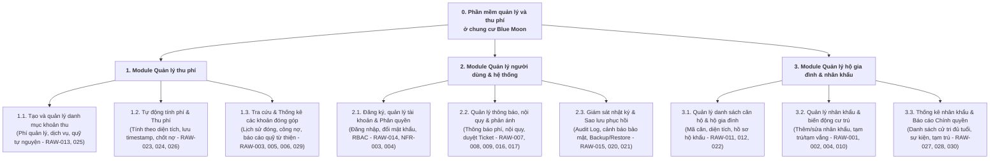

# BÀI 4.2: TÀI LIỆU KẾ HOẠCH DỰ ÁN (WORK BREAKDOWN STRUCTURE & GANTT CHART)
*Học phần: Nhập môn Công nghệ Phần mềm – Khoa Khoa học và Kỹ thuật Máy tính (SoICT/HUST)*  
**Dự án:** Xây dựng phần mềm quản lý và thu phí ở chung cư Blue Moon (BlueMoon v1.0)

---

## 1. CẤU TRÚC PHÂN CẤP CÔNG VIỆC THEO SẢN PHẨM BÀN GIAO (PRODUCT-ORIENTED WBS)

Theo hướng dẫn của Bộ môn Công nghệ phần mềm (Hình 4-1), cấu trúc phân cấp công việc theo sản phẩm bàn giao lấy **Mức 0** là *Phần mềm quản lý và thu phí ở chung cư Blue Moon*, **Mức 1** là *03 Module phần mềm chính*, và **Mức 2 – Mức 3** là các tính năng / gói công việc cụ thể được tổng hợp từ tập yêu cầu `RAW-001` $\rightarrow$ `RAW-030` và `NFR-01` $\rightarrow$ `NFR-05` (đảm bảo **quy tắc 100%**):

---

## 2. CẤU TRÚC PHÂN CẤP CÔNG VIỆC THEO QUY TRÌNH (PROCESS-ORIENTED WBS)

### 2.1. Cấu trúc phân cấp công việc theo quy trình Waterfall (Hình 4-2)
- **0. Phần mềm quản lý và thu phí ở chung cư Blue Moon**
  - **1. Quản lý dự án:** `1.1. Khởi tạo & lập tuyên ngôn dự án` | `1.2. Lập kế hoạch dự án & rủi ro` | `1.3. Giám sát và kiểm soát tiến độ` | `1.4. Nghiệm thu và kết thúc dự án`.
  - **2. Xây dựng phần mềm:**
    - **2.1. Phân tích yêu cầu (Elicitation & Specification):** Khai phá yêu cầu thô (`Client's Wish List`, `As-Is`, `Visionary`, `NFR`) $\rightarrow$ Chuẩn hóa `Epic`, `Feature`, `User Story`, `Acceptance Criteria`, `Product Backlog`, `Traceability Matrix`.
    - **2.2. Thiết kế hệ thống:**
      - `2.2.1. Thiết kế chức năng` (Biểu đồ Use Case, Sequence, Activity).
      - `2.2.2. Thiết kế giao diện` (Mockup/Prototype thuần Việt, font $\ge 12\text{pt}$, nộp phí $\le 3$ bước).
      - `2.2.3. Thiết kế dữ liệu` (Lược đồ CSDL MySQL, kiểu `DECIMAL`):
        - `2.2.3.1. Module Quản lý thu phí` (*Tạo khoản thu*, *Thu phí*, *Thống kê các khoản đóng góp*).
        - `2.2.3.2. Module Quản lý người dùng` (*Quản lý tài khoản & RBAC*, *Thông báo & Phản ánh*, *Audit Log & Backup*).
        - `2.2.3.3. Module Quản lý hộ gia đình` (*Căn hộ & Hộ khẩu*, *Nhân khẩu & Tạm trú*, *Báo cáo cử tri & hành chính*).
      - `2.2.4. Rà soát thiết kế` (Design Review).
      - `2.2.5. Thiết kế cơ chế phân quyền & bảo mật` (RBAC, `bcrypt`, Nghị định 13/2023/NĐ-CP).
    - **2.3. Cài đặt (Lập trình):** Cài đặt tầng `UI – Service – DAO` cho 3 Module.
    - **2.4. Kiểm thử:** Unit Test, Integration Test, System Test, Kiểm thử hiệu năng & UAT 1, UAT 2.
  - **3. Chăm sóc hỗ trợ:** `3.1. Đào tạo & hướng dẫn người dùng cuối` | `3.2. Hỗ trợ xử lý lỗi sau bàn giao`.
  - **4. Vận hành phần mềm:** `4.1. Đóng gói bộ cài đặt Windows` | `4.2. Triển khai & cấu hình sao lưu tự động tại BQT`.

### 2.2. Cấu trúc phân cấp công việc theo quy trình Scrum (Hình 4-3)

```mermaid
flowchart TD
    S0["<b>0. Phần mềm quản lý và thu phí ở chung cư Blue Moon</b>"]
    S0 --> S1["<b>1. Quản lý dự án</b>"]
    S0 --> S2["<b>2. Xây dựng phần mềm (Scrum Sprints)</b>"]
    S0 --> S3["<b>3. Chăm sóc hỗ trợ & Vận hành</b>"]

    S1 --> S1_1["1.1. Lập kế hoạch<br/>(Tuyên ngôn, WBS, Rủi ro)"]
    S1 --> S1_2["1.2. Giám sát và kiểm soát<br/>(Daily Scrum, Báo cáo tuần)"]
    S1 --> S1_3["1.3. Kết thúc dự án<br/>(Nghiệm thu UAT 1, UAT 2)"]
    S1 --> S1_4["1.4. Quản lý hợp đồng<br/>& Kiểm soát thay đổi"]

    S2 --> S2_1["<b>2.1. Module Quản lý thu phí</b>"]
    S2 --> S2_2["<b>2.2. Module Quản lý người dùng</b>"]
    S2 --> S2_3["<b>2.3. Module Quản lý hộ gia đình</b>"]

    S2_1 --> S2_1_1["2.1.1. Thiết lập yêu cầu<br/>(Wish List, User Story, AC)"]
    S2_1 --> S2_1_2["2.1.2. Lập kế hoạch phân đoạn<br/>(Sprint Planning & Thiết kế)"]
    S2_1 --> S2_1_3["2.1.3. Phát triển & Kiểm thử"]
    S2_1 --> S2_1_4["2.1.4. Vận hành & Demo Sprint"]

    S2_1_3 --> S2_1_3_1["2.1.3.1. Tạo khoản thu<br/>(Bắt buộc & Tự nguyện)"]
    S2_1_3 --> S2_1_3_2["2.1.3.2. Tính phí tự động,<br/>Thu phí & Chốt sổ nợ"]
    S2_1_3 --> S2_1_3_3["2.1.3.3. Thống kê các khoản<br/>đóng góp & Quỹ từ thiện"]

    S2_2 --> S2_2_1["2.2.1. Thiết lập yêu cầu"]
    S2_2 --> S2_2_2["2.2.2. Lập kế hoạch phân đoạn"]
    S2_2 --> S2_2_3["2.2.3. Phát triển (Tài khoản, RBAC,<br/>Thông báo, Phản ánh, Audit, Backup)"]
    S2_2 --> S2_2_4["2.2.4. Vận hành & Demo Sprint"]

    S2_3 --> S2_3_1["2.3.1. Thiết lập yêu cầu"]
    S2_3 --> S2_3_2["2.3.2. Lập kế hoạch phân đoạn"]
    S2_3 --> S2_3_3["2.3.3. Phát triển (Căn hộ, Hộ khẩu,<br/>Nhân khẩu, Tạm trú, Báo cáo cử tri)"]
    S2_3 --> S2_3_4["2.3.4. Vận hành & Demo Sprint"]

    S3 --> S3_1["3.1. Hỗ trợ người dùng cuối<br/>(Hướng dẫn sử dụng & cài đặt)"]
    S3 --> S3_2["3.2. Áp dụng công cụ hỗ trợ<br/>(Git, Jira/Trello, MySQL Backup)"]
    S3 --> S3_3["3.3. Áp dụng tiêu chuẩn<br/>(INVEST, GWT, NFR, NĐ 13/2023)"]
```

---

## 3. BẢNG PHÂN RÃ NHIỆM VỤ CHI TIẾT & LỊCH TRÌNH GANTT (WBS TASK LIST & GANTT SCHEDULE)

*Thời gian thực hiện dự án: **Quý IV/2026 (01/10/2026 – 30/12/2026, tổng cộng 13 tuần / 90 ngày)**.*

| Mã WBS | Tên gói công việc / Nhiệm vụ (Task) | Mã yêu cầu liên quan | Người phụ trách | Bắt đầu | Kết thúc | Số ngày | Phụ thuộc |
| :---: | :--- | :--- | :--- | :---: | :---: | :---: | :---: |
| **1** | **QUẢN LÝ DỰ ÁN** | **Toàn dự án** | **Nguyễn Văn An (PM)** | **01/10/2026** | **30/12/2026** | **90** | — |
| 1.1 | Khởi tạo dự án & lập Tuyên ngôn dự án (Project Charter) | Bài 4.1 | Nguyễn Văn An | 01/10/2026 | 04/10/2026 | 4 | — |
| 1.2 | Lập Kế hoạch dự án (WBS, Gantt) & Kế hoạch quản lý rủi ro | Bài 4.2, Bài 4.3 | Nguyễn Văn An | 05/10/2026 | 08/10/2026 | 4 | 1.1 |
| 1.3 | Giám sát, kiểm soát tiến độ (Họp sáng hàng ngày, Báo cáo tuần) | Chiến lược TT | Nguyễn Văn An | 09/10/2026 | 25/12/2026 | 78 | 1.2 |
| 1.4 | Quản lý hợp đồng, kiểm soát thay đổi & Tổng kết nghiệm thu dự án | Mốc hoàn thành | Nguyễn Văn An, Lê Văn B | 16/12/2026 | 30/12/2026 | 15 | 2.4 |
| **2** | **XÂY DỰNG PHẦN MỀM BLUEMOON V1.0** | **30 RAW + 16 NFR** | **Toàn đội dự án** | **05/10/2026** | **20/12/2026** | **77** | **1.1** |
| **2.0** | **Khai phá yêu cầu, Phân tích & Thiết kế tổng thể nền tảng** | **OBJ-01 $\rightarrow$ OBJ-08** | **Trần Thị Bình, Lê Hoàng Cường** | **05/10/2026** | **25/10/2026** | **21** | **1.1** |
| 2.0.1 | Phỏng vấn BQT, Quan sát Thủ quỹ, Khảo sát Cư dân & Chính quyền | `RAW-001` $\rightarrow$ `RAW-030` | Trần Thị Bình (BA) | 05/10/2026 | 11/10/2026 | 7 | 1.1 |
| 2.0.2 | Lập Client's Wish List, As-Is Scenario, Visionary Scenario & NFR | `OBJ-01` $\rightarrow$ `OBJ-04` | Trần Thị Bình (BA) | 08/10/2026 | 12/10/2026 | 5 | 2.0.1 |
| 2.0.3 | Chuẩn hóa Epic, Feature, User Story (INVEST), AC (GWT), Backlog & Traceability | `OBJ-05` $\rightarrow$ `OBJ-08` | Trần Thị Bình, Vũ Quốc Khánh | 13/10/2026 | 15/10/2026 | 3 | 2.0.2 |
| 2.0.4 | Thiết kế kiến trúc (`UI-Service-DAO`), Thiết kế giao diện & CSDL MySQL (`DECIMAL`) | `NFR-03`, `NFR-04`, `NFR-05` | Lê Hoàng Cường, Phạm Minh Đức | 16/10/2026 | 25/10/2026 | 10 | 2.0.3 |
| **2.1** | **Module 1: Quản lý thu phí (Sprint 2 & Sprint 3)** | **EPIC-02, EPIC-03, EPIC-04** | **Lê Hoàng Cường, Phạm Minh Đức** | **05/11/2026** | **25/11/2026** | **21** | **2.0.4** |
| 2.1.1 | Thiết lập & làm mịn yêu cầu chi tiết Module Quản lý thu phí | `RAW-003, 005, 006, 013, 023..026, 029` | Trần Thị Bình | 05/11/2026 | 06/11/2026 | 2 | 2.0.4 |
| 2.1.2 | Lập kế hoạch phân đoạn & thiết kế chi tiết bảng Hóa đơn, Khoản thu, Giao dịch | `NFR-03`, `NFR-010` | Lê Hoàng Cường | 07/11/2026 | 08/11/2026 | 2 | 2.1.1 |
| 2.1.3.1 | Phát triển tính năng **Tạo và quản lý danh mục khoản thu** (phí bắt buộc theo diện tích & quỹ đóng góp tự nguyện linh hoạt) | `RAW-013`, `RAW-025` | Phạm Minh Đức, Hoàng Thu Hà | 09/11/2026 | 13/11/2026 | 5 | 2.1.2 |
| 2.1.3.2 | Phát triển tính năng **Tự động tính phí & Thu phí** (nhân diện tích $\times$ đơn giá, cộng nợ cũ, ghi nhận nộp tiền $\le 3$ bước, lưu `timestamp`, chốt sổ nợ) | `RAW-023`, `RAW-024`, `RAW-026`, `NFR-002` | Lê Hoàng Cường, Hoàng Thu Hà | 14/11/2026 | 20/11/2026 | 7 | 2.1.3.1 |
| 2.1.3.3 | Phát triển tính năng **Tra cứu & Thống kê các khoản đóng góp** (cư dân xem phí/công nợ từng kỳ, BQT xuất báo cáo thu chi quỹ từ thiện) | `RAW-003`, `RAW-005`, `RAW-006`, `RAW-029` | Phạm Minh Đức, Hoàng Thu Hà | 21/11/2026 | 24/11/2026 | 4 | 2.1.3.2 |
| 2.1.4 | Kiểm thử tích hợp & Demo vận hành Module Quản lý thu phí | DoD Module 1 | Vũ Quốc Khánh | 25/11/2026 | 25/11/2026 | 1 | 2.1.3.3 |
| **2.2** | **Module 2: Quản lý người dùng & hệ thống (Sprint 1 & Sprint 3)** | **EPIC-05, EPIC-06** | **Lê Hoàng Cường, Hoàng Thu Hà** | **26/10/2026** | **28/11/2026** | **34** | **2.0.4** |
| 2.2.1 | Thiết lập yêu cầu & kịch bản kiểm thử Module Quản lý người dùng | `RAW-007..009`, `RAW-014..017`, `RAW-020, 021` | Trần Thị Bình, Vũ Quốc Khánh | 26/10/2026 | 27/10/2026 | 2 | 2.0.4 |
| 2.2.2 | Lập kế hoạch phân đoạn & thiết kế cơ chế bảo mật (`bcrypt`, RBAC, TLS) | `NFR-02`, `NFR-003..005` | Lê Hoàng Cường | 28/10/2026 | 28/10/2026 | 1 | 2.2.1 |
| 2.2.3.1 | Phát triển tính năng **Đăng ký, Đăng nhập, Đổi mật khẩu & Phân quyền RBAC** (Ban quản trị, Thủ quỹ, Cư dân; khóa sau 5 lần sai) | `RAW-014`, `NFR-003`, `NFR-004` | Lê Hoàng Cường, Hoàng Thu Hà | 29/10/2026 | 02/11/2026 | 5 | 2.2.2 |
| 2.2.3.2 | Phát triển tính năng **Thông báo điện tử, Quản lý nội quy & Xử lý phản ánh/yêu cầu (Ticket)** | `RAW-007`, `RAW-008`, `RAW-009`, `RAW-016`, `RAW-017` | Hoàng Thu Hà, Phạm Minh Đức | 20/11/2026 | 25/11/2026 | 6 | 2.2.3.1 |
| 2.2.3.3 | Phát triển tính năng **Nhật ký hoạt động (Audit Log), Cảnh báo truy cập trái phép & Sao lưu/Phục hồi tự động (Backup/Restore)** | `RAW-015`, `RAW-020`, `RAW-021`, `NFR-007`, `NFR-008`, `NFR-015` | Lê Hoàng Cường, Phạm Minh Đức | 26/11/2026 | 28/11/2026 | 3 | 2.2.3.2 |
| 2.2.4 | Kiểm thử bảo mật, diễn tập Restore ($\le 1\text{h}$) & Vận hành Module 2 | DoD Module 2 | Vũ Quốc Khánh | 28/11/2026 | 28/11/2026 | 1 | 2.2.3.3 |
| **2.3** | **Module 3: Quản lý hộ gia đình & nhân khẩu (Sprint 1 & Sprint 2)** | **EPIC-01, EPIC-04** | **Phạm Minh Đức, Hoàng Thu Hà** | **26/10/2026** | **15/11/2026** | **21** | **2.0.4** |
| 2.3.1 | Thiết lập yêu cầu chi tiết Module Quản lý hộ gia đình & nhân khẩu | `RAW-001, 002, 004, 010..012, 022, 027, 028, 030` | Trần Thị Bình | 26/10/2026 | 27/10/2026 | 2 | 2.0.4 |
| 2.3.2 | Lập kế hoạch phân đoạn & thiết kế bảng Căn hộ, Hộ khẩu, Nhân khẩu, Tạm trú | `NFR-011`, `NFR-02` | Phạm Minh Đức | 28/10/2026 | 28/10/2026 | 1 | 2.3.1 |
| 2.3.3.1 | Phát triển tính năng **Quản lý danh sách căn hộ (diện tích) & Hồ sơ hộ gia đình** | `RAW-011`, `RAW-012`, `RAW-022` | Phạm Minh Đức, Hoàng Thu Hà | 29/10/2026 | 03/11/2026 | 6 | 2.3.2 |
| 2.3.3.2 | Phát triển tính năng **Quản lý nhân khẩu, Tạm trú/Tạm vắng & Cư dân tự tra cứu/đề xuất cập nhật** | `RAW-001`, `RAW-002`, `RAW-004`, `RAW-010` | Phạm Minh Đức, Hoàng Thu Hà | 04/11/2026 | 10/11/2026 | 7 | 2.3.3.1 |
| 2.3.3.3 | Phát triển tính năng **Trích xuất danh sách cử tri đủ tuổi bầu cử, dân cư sự kiện & báo cáo tạm trú/tạm vắng cho Chính quyền** | `RAW-027`, `RAW-028`, `RAW-030` | Phạm Minh Đức | 11/11/2026 | 14/11/2026 | 4 | 2.3.3.2 |
| 2.3.4 | Kiểm thử tích hợp & Demo vận hành Module Quản lý hộ gia đình | DoD Module 3 | Vũ Quốc Khánh | 15/11/2026 | 15/11/2026 | 1 | 2.3.3.3 |
| **2.4** | **Kiểm thử tổng thể hệ thống, UAT 1 & UAT 2** | **Mốc 30/11 & 15/12** | **Vũ Quốc Khánh & Toàn đội** | **26/11/2026** | **15/12/2026** | **20** | **2.1, 2.2, 2.3** |
| 2.4.1 | Kiểm thử tích hợp toàn hệ thống & Kiểm thử hiệu năng (200 CCU, 1.000 hộ) | `NFR-01`, `NFR-001`, `NFR-011` | Vũ Quốc Khánh, Lê Hoàng Cường | 26/11/2026 | 29/11/2026 | 4 | 2.1.4, 2.3.4 |
| 2.4.2 | **Bàn giao phiên bản thử nghiệm (First UAT – 30/11/2026)** & Thu thập góp ý của BQT, Thủ quỹ, Cư dân | Mốc UAT 1 | Nguyễn Văn An, Trần Thị Bình | 30/11/2026 | 05/12/2026 | 6 | 2.4.1 |
| 2.4.3 | Khắc phục lỗi (Bug fixing), tối ưu giao diện (SUS $\ge 70$) & hoàn thiện hệ thống | `NFR-04`, `NFR-009` | Lê Hoàng Cường, Phạm Minh Đức, Hoàng Thu Hà | 06/12/2026 | 14/12/2026 | 9 | 2.4.2 |
| 2.4.4 | **Bàn giao phiên bản chính thức (Second UAT – 15/12/2026)** | Mốc UAT 2 | Toàn đội dự án & Khách hàng | 15/12/2026 | 15/12/2026 | 1 | 2.4.3 |
| **3** | **CHĂM SÓC HỖ TRỢ & VẬN HÀNH PHẦN MỀM** | **Bàn giao cuối** | **Toàn đội dự án** | **01/10/2026** | **30/12/2026** | **90** | — |
| 3.1 | Hỗ trợ người dùng cuối: Biên soạn Hướng dẫn sử dụng, Hướng dẫn cài đặt, đóng gói bộ cài Windows & Đào tạo BQT/Thủ quỹ | Sản phẩm bàn giao | Trần Thị Bình, Hoàng Thu Hà | 16/12/2026 | 28/12/2026 | 13 | 2.4.4 |
| 3.2 | Áp dụng công cụ hỗ trợ (Quản trị Git/GitHub, Trello/Jira, CI/CD, MySQL Workbench) | Công cụ dự án | Lê Hoàng Cường | 01/10/2026 | 30/12/2026 | 90 | — |
| 3.3 | Áp dụng tiêu chuẩn chất lượng (INVEST, GWT, Coding Convention, NĐ 13/2023/NĐ-CP) | Tiêu chuẩn | Vũ Quốc Khánh, Trần Thị Bình | 01/10/2026 | 30/12/2026 | 90 | — |

---

## 4. BIỂU ĐỒ GANTT (GANTT CHART THEO TUẦN – QUÝ IV/2026)

Bảng biểu đồ Gantt dưới đây thể hiện tiến độ thực hiện các gói công việc WBS theo 13 tuần của Quý IV/2026 (từ `T1: 01/10` đến `T13: 30/12`), bám sát 3 mốc thời gian bắt buộc trong Tuyên ngôn dự án (**30/11: First UAT**, **15/12: Second UAT**, **30/12: Hoàn thành**):

| Mã WBS | Hạng mục công việc | T1 01-07/10 | T2 08-15/10 | T3 16-23/10 | T4 24-31/10 | T5 01-07/11 | T6 08-15/11 | T7 16-23/11 | T8 24-30/11 | T9 01-07/12 | T10 08-15/12 | T11 16-22/12 | T12-13 23-30/12 |
| :---: | :--- | :---: | :---: | :---: | :---: | :---: | :---: | :---: | :---: | :---: | :---: | :---: | :---: |
| **1.1 - 1.2** | Khởi tạo dự án, Tuyên ngôn, Kế hoạch & Rủi ro | ███ | █ | | | | | | | | | | |
| **1.3 - 1.4** | Giám sát tiến độ tuần & Quản lý hợp đồng | | ███ | ███ | ███ | ███ | ███ | ███ | ███ | ███ | ███ | ███ | ███ |
| **2.0.1 - 2.0.3** | Khai phá yêu cầu (Wish List, As-Is, Visionary, Backlog) | ███ | ███ | | | | | | | | | | |
| **2.0.4** | Phân tích & Thiết kế Kiến trúc, Giao diện, CSDL MySQL | | | ███ | █ | | | | | | | | |
| **2.3** | **Module 3:** Quản lý hộ gia đình, nhân khẩu & báo cáo cử tri | | | | ██ | ███ | ███ | | | | | | |
| **2.2 (P1)** | **Module 2 (Phần 1):** Tài khoản, Đăng nhập & Phân quyền RBAC | | | | ██ | █ | | | | | | | |
| **2.1** | **Module 1:** Tạo khoản thu, Tự động tính phí, Thu phí & Thống kê | | | | | █ | ███ | ███ | █ | | | | |
| **2.2 (P2)** | **Module 2 (Phần 2):** Thông báo, Nội quy, Phản ánh, Audit & Backup | | | | | | | ██ | ███ | | | | |
| **2.4.1 - 2.4.2** | Kiểm thử hệ thống & **Bàn giao thử nghiệm (First UAT: 30/11)** | | | | | | | | ★██ | ██ | | | |
| **2.4.3 - 2.4.4** | Sửa lỗi, tối ưu UI/UX & **Bàn giao chính thức (Second UAT: 15/12)** | | | | | | | | | █ | ██★ | | |
| **3.1** | Đóng gói bộ cài Windows, Hướng dẫn sử dụng & **Hoàn thành (30/12)** | | | | | | | | | | | ███ | ██★ |
| **3.2 - 3.3** | Áp dụng công cụ hỗ trợ (Git, Jira) & Tiêu chuẩn chất lượng | ███ | ███ | ███ | ███ | ███ | ███ | ███ | ███ | ███ | ███ | ███ | ███ |
